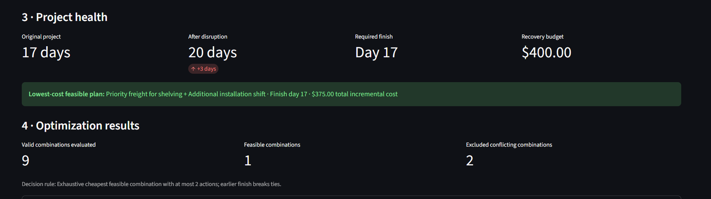
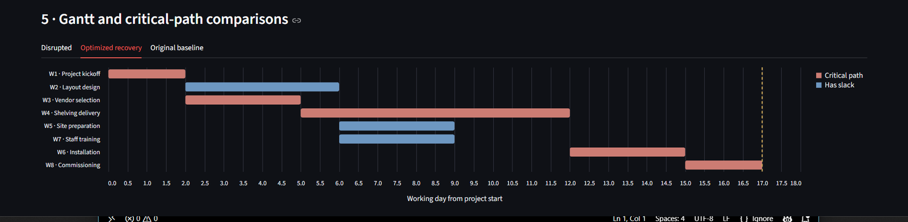
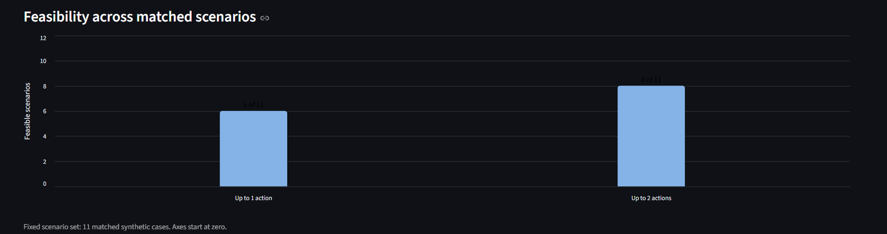
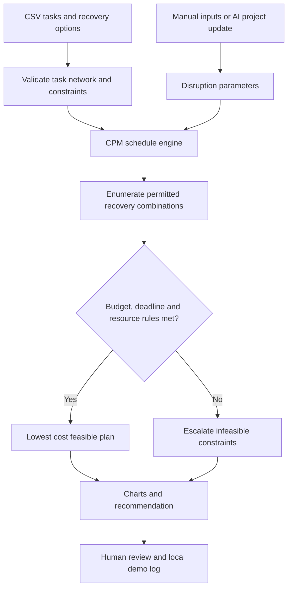

# ProjectPulse

**AI-assisted project scheduling & recovery optimization**  
*A portfolio prototype combining Industrial Engineering methods, constrained decision-making, and an optional AI agent.*



ProjectPulse helps an engineering project coordinator answer: **Which corrective-action plan can recover a delayed project at the lowest incremental cost, while respecting deadline, budget, compatibility, and shared-resource constraints?**

Rather than asking a language model to guess project dates, the application uses a deterministic **Critical Path Method (CPM)** engine and an exhaustive bounded optimization search. The optional AI interface converts a natural-language project update into validated tool inputs and explains the calculated outcome. All sample projects and costs are **fictional**.

## Capabilities

- Upload project tasks and recovery options as CSV files; sample networks include equipment installation, warehouse automation, and a plastic-recycling sorting-line upgrade.
- Model a disruption to any existing task and recalculate earliest/latest times, slack, critical tasks, and project completion.
- Compare individual and multi-action recovery plans under deadlines, budgets, mutually exclusive actions, and conservative resource-capacity limits.
- View Gantt charts for the original, disrupted, and optimized schedules.
- Use an optional OpenAI-powered assistant to interpret an update and call the deterministic scheduling tool. **Manual mode requires no API key or usage credits.**
- Record human-reviewed **fictional** decisions in a local audit log, without making purchases, sending messages, or modifying actual project systems.
- Reproduce predefined test cases and performance benchmarks offline.

## Demonstration: two actions beat one

A synthetic warehouse automation project has a baseline completion of **17 working days**. A simulated shelving-delivery delay pushes completion to **day 20**. The recovery budget is **$400**, with a **day-17** deadline.

| Modeled action | Finish | Incremental cost | Meets day-17 deadline and $400 budget? |
|---|---:|---:|:---:|
| No action | 20 | $0 | No |
| Priority freight only | 18 | $250 | No |
| Installation overtime only | 19 | $125 | No |
| **Priority freight + overtime** | **17** | **$375** | **Yes** |

The example assumes the freight and overtime options are available as specified. The optimized Gantt chart shows the effects of the combined changes.



## Measured results on synthetic tests

| Offline evaluation | Result |
|---|---:|
| Predeclared expected-output scenarios passed | **12 / 12** |
| Matched scenarios feasible with up to one action | **6 / 11** |
| Matched scenarios feasible with up to two actions | **8 / 11** |
| Additional feasible cases allowing two actions | **2** |
| Constraint monotonicity checks passed | **11 / 11** |



These metrics establish behavior **only within the curated fictional cases**. They do *not* demonstrate model-prediction accuracy, actual on-time delivery improvements, or real financial savings. The optional LLM tool-use integration was tested interactively; the evaluation figures above are **deterministic Python-engine tests**. See [methodology and limitations](docs/METHODOLOGY.md) and the reproducible evaluation report under `reports/`.

## Setup (Windows PowerShell / macOS / Linux)

Python 3.11+ recommended. From the repository root:

```bash
python -m pip install -r requirements.txt
python -m streamlit run app.py
```

Use **Manual / no API cost** to run scheduling and optimization offline. For optional AI assistance, copy `.env.example` to `.env`, set `OPENAI_API_KEY` locally, and keep `.env` private. ChatGPT subscriptions and OpenAI API billing are separate. Never commit API credentials.

To run tests and evaluation:

```bash
python -m unittest discover -s tests -v
python phase6_evaluate.py
python -m streamlit run evaluation_dashboard.py
```

The evaluator writes local artifacts under `outputs/phase6/` (ignored by Git). An example report is included in `reports/`.

## How it works



The model may request calculations, but **Python scheduling and optimization results are authoritative**. No real procurement, staffing, or messaging action is executed.

## Repository structure

```text
app.py                      # Main Streamlit project recovery app
phase4_engine.py            # CSV parsing and generalized scheduling inputs
phase5_engine.py            # Multi-action optimization and resource policies
src/engine.py               # Critical Path Method calculations
phase6_evaluate.py          # Offline synthetic benchmark and report generator
evaluation_dashboard.py     # Evaluation visualizations with zero-based comparison chart
phase5_samples/             # Three fictional project datasets and candidate actions
sample_projects/            # Earlier sample CSVs for backwards-compatible uploads
data/                       # Introductory CSV examples
tests/                      # Automated regression tests
assets/                     # Dashboard screenshots
docs/                       # Methodology, CSV schema, portfolio case study
reports/                    # Reference report from the fictional evaluation
.github/workflows/          # GitHub Actions test workflow
```

## Data schema & methodology

See [CSV field definitions](docs/DATA_FORMAT.md), [technical method and limitations](docs/METHODOLOGY.md), and a [portfolio case study](docs/PORTFOLIO_CASE_STUDY.md). Recovery candidates specify **total replacement task durations** and **incremental costs**; the tool does not infer actual vendor quotations.

## Safety and limitations

- All included companies, costs, delivery assumptions, and improvements are fictional demonstration inputs.
- The engine evaluates **one reported task disruption per run**, with task durations represented as integer relative working days.
- Shared-resource capacities are reserved conservatively for entire plans; this is *not* a full time-phased resource-constrained project scheduling solver.
- The optimizer considers only supplied candidate actions, up to its bounded search limits (20 candidate actions; 3 selected actions).
- Real-world use requires verified supplier capacity/pricing, secure data integration, calendars, uncertainty modeling, and human approval.
- Approval logs are local demonstration records, **not** actual authorization or confirmed execution.

## Project status

Self-directed, functional portfolio prototype. The included evaluation covers offline mathematical calculations. Planned next steps could include calendar-aware resource leveling, probabilistic delay estimates, broader AI-tool interpretation tests, and a hosted demo with secure credentials.